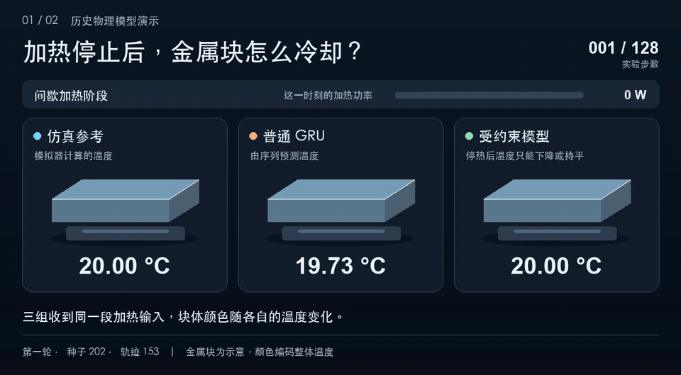
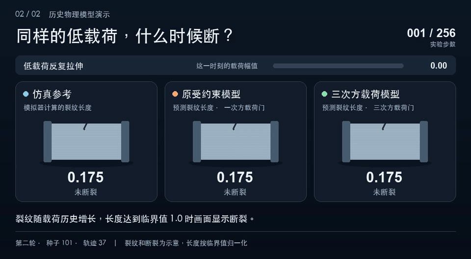
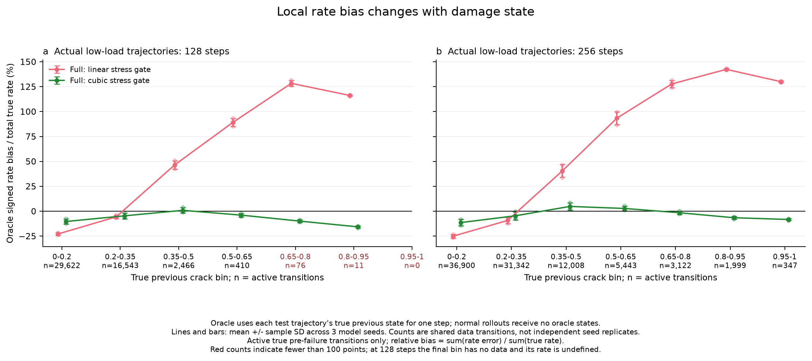

# History-Dependent Physics Models

本地可训练的历史依赖物理模型：热积累与冷却、疲劳裂纹增长与断裂预测。

Small, reproducible experiments comparing recurrent models with explicit physical
state updates. This repository is independent of OASIS and requires no pretrained
video model, Minecraft installation, external dataset, or GPU.

## 演示

两段动画使用已保存的测试轨迹。金属块和裂缝是示意，温度、裂纹长度和报断时刻取自实验记录。[下载 22 秒 MP4 合辑](https://raw.githubusercontent.com/JANZeee/history-dependent-physics/main/media/demos/history-physics-demo.mp4)

**加热与冷却。** 第 32 步后停止加热。第 128 步的仿真参考温度为 26.18 °C，普通 GRU 预测 40.01 °C，受约束模型预测 24.34 °C。



**疲劳与断裂。** 同一条低载荷轨迹上，原受约束模型在第 121 步报断，仿真参考在第 158 步断裂，三次方载荷模型在第 159 步报断。



## 研究贡献

**拆开状态反馈与物理约束的作用。** 在同一 GRU 上做四组对照，分别开关上一预测状态的反馈和物理投影。再在同形的状态模型上逐步加入载荷门控、非负增量和断裂截断。单独加入状态反馈没有跨条件稳定的长程收益。在低载荷 256 步测试中，加入断裂截断的训练版本把断裂前 RMSE 从 0.1452 降到 0.0819，误报率却从 3.24% 升到 10.03%。

**用真实前态定位提前报断。** 诊断时逐步给模型真实裂纹长度，只测当前一步的增长率，避免前面步骤的预测误差混进来。当真实裂纹为临界长度的 35%–50% 和 50%–65% 时，原模型的增长率分别高估约 46% 和 89%。随后固定权重、输入和断裂判定阈值，仅关闭推理时的上限截断。3,072 条诊断轨迹的首次越界时刻完全一致。两项检查共同把排查重点指向越界前、特定损伤阶段的增长率偏差。

**干预增长率，并同时衡量误报和漏报。** 三次方载荷门保留停载保持、非负增量和断裂截断。另一项干预在独立验证集上拟合统一乘数，再用它降低原模型的增长率。以下是同一低载荷 256 步测试的三种子均值。每个种子共评估 512 条轨迹，误报以 329 条窗口内未断裂轨迹为分母，漏报以 183 条窗口内断裂轨迹为分母。

| 模型或干预 | 误报率 | 漏报率 |
|---|---:|---:|
| 原完整模型 | 10.03% | 0% |
| 三次方载荷门 | 1.93% | 7.29% |
| 原模型统一降速 | 0% | 39.16% |

三次方关系来自参考模拟器，替换载荷门也改变了初始增量尺度。这个对照衡量的是合成实验中这项干预的效果，随机载荷下的收益也不一致。[完整消融、误报诊断与逐种子计数](research/history_physics_20261110/ablation/RESULTS.md)

## 已完成的实验

| 实验 | 设计 | 报告 |
|---|---|---|
| 本机可行性 | 小型数值与视觉网络的 CPU/MPS 训练测速 | [说明](experiments/history_physics_local_20261110/README.md) |
| 第一轮 | 热/疲劳两任务 × GRU/受约束模型 × 3 种子，12次训练 | [完整结果](research/history_physics_20261110/benchmark/RESULTS.md) |
| 第二轮 | 同形GRU状态反馈×投影；状态MLP逐级约束；45次训练 | [消融与机制诊断](research/history_physics_20261110/ablation/RESULTS.md) |

第二轮表明：显式状态反馈没有跨条件稳定的长程收益；物理约束分别改善停载保持、单调性和断裂后稳定性，但不能保证增长率正确。原完整模型在低载荷、中后期裂纹状态下高估增长率，导致部分轨迹提前断裂。

| 低载128步，3种子均值±样本标准差 | 裂纹RMSE | 断裂误报率 |
|---|---:|---:|
| 原完整状态模型 | 0.0422 ± 0.0011 | 4.57% ± 0.11% |
| 三次方载荷先验 | 0.0097 ± 0.0016 | 0%，三种子均为零 |

所有数字来自固定合成动力学，不是对真实材料或视觉世界模型的验证。



## 环境与复现

记录环境为 Python 3.12.13、Apple M2 Pro、16 GiB内存。正式数值实验用CPU FP32、2线程，第一轮训练/验证合计约120秒，第二轮约398秒。不同硬件与库实现可能产生数值差异。

```bash
python3.12 -m venv .venv
.venv/bin/python -m pip install -r experiments/history_physics_requirements.txt

# 第一轮：独立训练、评测、绘图和审计。
.venv/bin/python -m unittest discover -s experiments/history_physics_benchmark_20261110 -p 'test_*.py' -v
.venv/bin/python experiments/history_physics_benchmark_20261110/train.py --output outputs/history_physics_benchmark_20261110
.venv/bin/python experiments/history_physics_benchmark_20261110/evaluate.py --output outputs/history_physics_benchmark_20261110
.venv/bin/python experiments/history_physics_benchmark_20261110/plot_results.py --output outputs/history_physics_benchmark_20261110
.venv/bin/python experiments/history_physics_benchmark_20261110/audit_results.py --output outputs/history_physics_benchmark_20261110

# 第二轮：先锁定独立验证集校准，再触碰新测试集。
.venv/bin/python -m unittest discover -s experiments/history_physics_ablation_20261110 -p 'test_*.py' -v
.venv/bin/python experiments/history_physics_ablation_20261110/train.py --output outputs/history_physics_ablation_20261110
.venv/bin/python experiments/history_physics_ablation_20261110/diagnostics.py --output outputs/history_physics_ablation_20261110 --calibrate-only
.venv/bin/python experiments/history_physics_ablation_20261110/evaluate.py --output outputs/history_physics_ablation_20261110
.venv/bin/python experiments/history_physics_ablation_20261110/diagnostics.py --output outputs/history_physics_ablation_20261110
.venv/bin/python experiments/history_physics_ablation_20261110/plot_reviewed.py --output outputs/history_physics_ablation_20261110
.venv/bin/python experiments/history_physics_ablation_20261110/plot_diagnostics.py --output outputs/history_physics_ablation_20261110
.venv/bin/python experiments/history_physics_ablation_20261110/audit_results.py --output outputs/history_physics_ablation_20261110
```

训练器拒绝覆盖已有冻结运行。上面的命令面向新clone，原始记录的公开副本保存在`research/`，不会与新生成的`outputs/`混用。两轮训练数据相同、测试种子不同；第二轮审计会核对第一轮数据manifest，因此按上面顺序运行。

详细设计见第一轮[协议](experiments/history_physics_benchmark_20261110/PROTOCOL.md)和第二轮[协议](experiments/history_physics_ablation_20261110/PROTOCOL.md)。正式训练源码保留原始字节与哈希；两轮分别通过14/19项自动检查，独立审计也已记录。报告生成器的案例文字绑定原始运行，不会把原结果套用到新训练。

## 原始结果附件与审计边界

仓库包含代码、报告、指标JSON、图表与审计记录。完整逐步预测、诊断数组和模型权重在[Release附件](https://github.com/JANZeee/history-dependent-physics/releases/tag/history-physics-2026-11-10)，包含832个结果文件。

下载`history-physics-20261110-evidence.tar.gz`及同名`.sha256`文件，在单独目录验证并解压：

```bash
shasum -a 256 -c history-physics-20261110-evidence.tar.gz.sha256
mkdir evidence-snapshot
tar -xzf history-physics-20261110-evidence.tar.gz -C evidence-snapshot
```

公开副本已将本机绝对路径改为相对路径；NPZ数值数组保持逐字节相同，checkpoint张量值保持相同。修改路径会改变JSON及checkpoint文件哈希，记录中的既有审计PASS与冻结哈希对应发布前的本地原件。请使用[发布manifest](research/history_physics_20261110/PUBLICATION_MANIFEST.json)核对原文件、公开附件与仓库副本的SHA256映射；不要把改写后的文件当成具有原哈希的对象。完整端到端复核应在新的输出目录重新训练与评测。

本仓库保留失败和负面结果，不声称模型已具备真实材料可靠性、通用物理推理或视频生成物理一致性。
