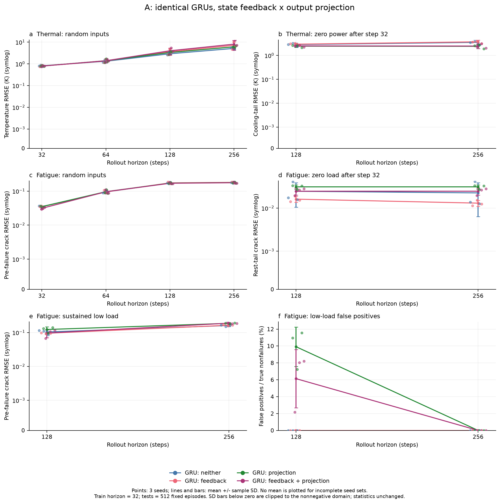
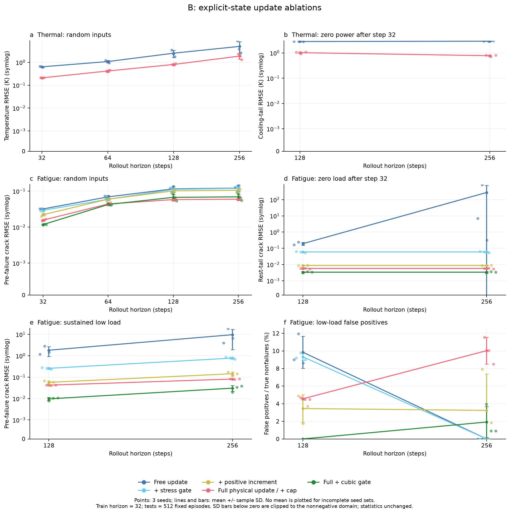
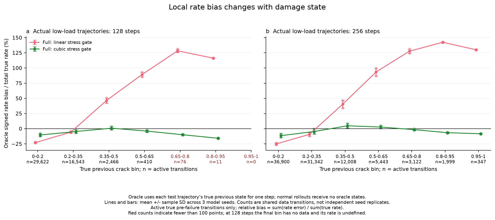
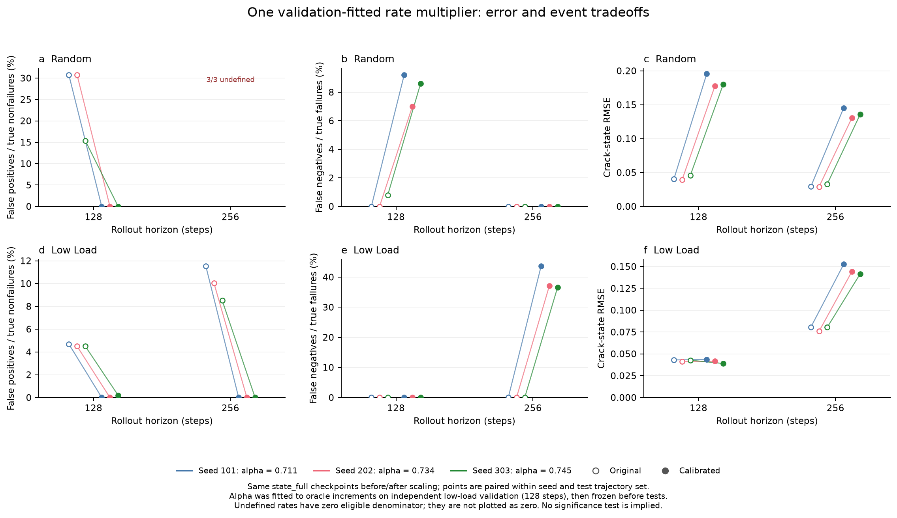

# 第二轮消融结果：显式状态反馈、物理约束与低载荷误报

已完成 **45 次训练、3 个种子、324 个模型–种子–测试条件评分**，无失败训练或非有限预测。主要结论：原完整模型的低载误报与**特定裂纹状态下的增长率失配**相符；把上一预测状态喂给 GRU 本身没有跨条件稳定的长程收益，而物理约束分别改善停载保持、单调性和断裂后的稳定性。正确的载荷机制先验改善了低载预测，但仍有误报/漏报及分布之间的取舍。

本轮采用新的独立测试集，不能把数值与第一轮同名指标直接作配对差。所有 ± 为种子 101/202/303 的样本标准差，不是置信区间；三个模型种子共享同一批数据。

## 设计与公平性

A 组是 2×2 析因实验：同一个 GRUCell(6,64)＋直接状态输出头，第六输入槽为零或上一预测状态；输出不投影或按物理可行域投影。四个模型参数量均为 13,889，同种子初始权重完全相同，输出偏置也相同。该对照识别的是**显式预测状态反馈**及**这个硬投影实现**，不涵盖所有显式状态架构。

B 组是在同形状态 MLP 上逐步加先验。疲劳五组都是 13,553 参数，同种子初始权重相同；自由有符号增量 → 乘归一化载荷 → 非负增量 → 临界值截断。另用三次方载荷替换一次载荷门。三次方来自参考模拟器的已知机制，属于更强先验，并改变初始增量尺度。热 MLP 两组均 13,666 参数，但自由残差到完整热更新同时改变多个性质，不作为单一约束的净效应。

训练复用第一轮固定的 5,000 条×32步训练集和 512 条×32步 ID 验证集。每次训练 1,500 个 Adam 更新、batch64、lr0.001、梯度裁剪1；每100步仅按 ID 验证 MSE 选 checkpoint。每个种子的45格相关运行使用配对 minibatch；无测试调参、提前停止、重试或删种子。家族内参数量一致，未匹配 FLOPs，也未对各模型分别搜索超参数。

新测试种子21003/21004/21005分别是随机载荷、32步后停载、持续低幅载荷。每项512条，先生成256步再取嵌套前缀。128/256步分别为训练时程的4/8倍；单步载荷和材料参数范围仍在训练支持内。预测全程不读当前真实状态。

本机 Apple M2 Pro，CPU FP32、2线程，训练与验证计时之和 **398.30秒（6.64分钟）**；训练进程峰值 RSS **328.6 MiB**。主评测约 32.19秒。所有运行都完成预算，未发现整步梯度全零的更新；投影候选可行率及梯度范数已保留，仍不能排除局部梯度截断的优化影响。

## A：状态反馈与硬投影的独立作用

| 模型 | 随机128 RMSE/K | 随机256 RMSE/K | 冷却尾段256 RMSE/K |
|---|---:|---:|---:|
| 普通 GRU | 2.925 ± 0.337 | 5.156 ± 0.413 | 3.527 ± 0.819 |
| GRU＋状态反馈 | 3.637 ± 1.165 | 7.148 ± 2.854 | 3.718 ± 0.610 |
| GRU＋物理投影 | 3.341 ± 0.570 | 6.077 ± 0.656 | 2.408 ± 0.455 |
| GRU＋反馈＋投影 | 4.013 ± 1.360 | 8.098 ± 3.833 | 2.467 ± 0.524 |

| 模型 | 随机256断裂前RMSE | 随机256漏报/% | 低载128误报/% | 低载256漏报/% |
|---|---:|---:|---:|---:|
| 普通 GRU | 0.1792 ± 0.0078 | 61.46 ± 7.50 | 0.00 ± 0.00 | 100.00 ± 0.00 |
| GRU＋状态反馈 | 0.1810 ± 0.0104 | 56.12 ± 14.89 | 0.00 ± 0.00 | 100.00 ± 0.00 |
| GRU＋物理投影 | 0.1786 ± 0.0095 | 15.17 ± 1.88 | 9.92 ± 2.33 | 48.09 ± 13.79 |
| GRU＋反馈＋投影 | 0.1766 ± 0.0103 | 13.28 ± 1.03 | 6.13 ± 3.45 | 62.48 ± 10.73 |

按每个种子的配对差计算，投影使热冷却尾段256 RMSE平均下降 **1.185±0.259 K**，但随机256温度 RMSE上升 **0.936±0.644 K**，三种子方向一致。热反馈主效应为 +2.006±3.635 K，方向并不稳定。

疲劳随机256的断裂前RMSE，反馈主效应约 −0.00009±0.01130，投影主效应 −0.00248±0.00890，不能据此声称稳定改善。投影则使该条件漏报率下降 **44.56±6.83个百分点**，并保证停载不变/损伤不减；同一投影在低载128使误报主效应增加 **8.02±1.70个百分点**。

普通GRU在低载测试没有误报，但256步真实断裂183例全部漏报。零误报不能单独证明更准确。投影两组在低载256也无误报，却仍漏掉约48%和62%的真实断裂。

## B：把不同物理先验逐步拆开

| 模型 | 低载128 RMSE | 低载128误报/% | 低载256断裂前RMSE | 低载256误报/% | 低载256漏报/% |
|---|---:|---:|---:|---:|---:|
| 显式状态：自由增量 | 1.8754 ± 0.9138 | 9.85 ± 1.82 | 9.7101 ± 7.7307 | 0.00 ± 0.00 | 57.92 ± 3.58 |
| ＋一次载荷门控 | 0.2629 ± 0.0244 | 9.33 ± 0.41 | 0.7800 ± 0.0840 | 0.00 ± 0.00 | 35.15 ± 6.61 |
| ＋非负增量 | 0.0581 ± 0.0103 | 3.46 ± 1.58 | 0.1452 ± 0.0275 | 3.24 ± 4.14 | 10.93 ± 5.01 |
| ＋断裂截断（原完整模型） | 0.0422 ± 0.0011 | 4.57 ± 0.11 | 0.0819 ± 0.0027 | 10.03 ± 1.52 | 0.00 ± 0.00 |
| 完整模型＋三次方载荷门 | 0.0097 ± 0.0016 | 0.00 ± 0.00 | 0.0306 ± 0.0095 | 1.93 ± 1.75 | 7.29 ± 4.42 |

载荷门控同时引入幅值关系和零载保持；非负参数化同时改变符号、函数形状和初始化的有效变化率。因此这些行是具体实现的嵌套干预，不能抽象成“正性约束在任何模型中的唯一效果”。

各约束解决的问题不同：门控消除静置漂移，但门控有符号模型在低载256仍约56.18%的步骤损伤下降；非负增量消除这种下降。没有断裂截断时，断裂后的值仍可继续增长：随机256整体RMSE分别为自由增量约590,530、门控约3,264、非负增量8.664；这些预测仍为有限数，已完整保留，没有静默修复。加截断后整体RMSE为0.03037。为避免被断裂后吸收态主导，上表优先列256步真实断裂前误差。

positive→full 在低载256将断裂前RMSE从0.1452降到0.0819，但误报率从3.24%升到10.03%，漏报从10.93%降到0。这说明约束也会通过训练改变增长率及事件取舍；并非物理行为合法就一定误报更少。

热 MLP 对照：

| 模型 | 随机128 RMSE/K | 随机256 RMSE/K | 冷却尾段256 RMSE/K |
|---|---:|---:|---:|
| 显式状态：自由增量 | 2.508 ± 0.881 | 4.973 ± 3.129 | 2.905 ± 0.059 |
| ＋断裂截断（原完整模型） | 0.807 ± 0.061 | 1.874 ± 0.510 | 0.776 ± 0.061 |

完整热更新优于自由热残差，但该桥接比较同时包含正热源、正散热率和指数更新形式，不能把全部收益归因于“增加了一个状态变量”。

## 低载误报原因：证据与排除项

**1. 误差在真实前态下就存在，并且依赖损伤阶段。** 对实际低载轨迹，单独给 MLP 真实前一步裂纹长度，测精确有限步增长率误差。此 oracle 仅用于诊断，没有用于正常预测、训练或主指标。

| 低载128真实前态区间 | 有载且真实未断裂转移数 | 原完整模型率相对偏差 | 三次方载荷模型率相对偏差 |
|---|---:|---:|---:|
| a<0.20 | 29,622 | −22.89% | −10.31% |
| 0.20≤a<0.35 | 16,543 | −5.66% | −4.64% |
| 0.35≤a<0.50 | 2,466 | +46.45% | +0.89% |
| 0.50≤a<0.65 | 410 | +89.21% | −3.93% |
| 0.65≤a<0.80 | 76 | +128.35% | −9.91% |
| 0.80≤a<0.95 | 11 | +116.23% | −15.70% |

率相对偏差为 sum(预测率−真实率)/sum(真实率)，再跨三个种子平均，非逐样本相对误差均值；同一数据转移数不代表独立种子样本数。高损伤区在128步的样本较少，图中另给256步的更充分观察。全体低载128的原模型率偏差平均只有约+3.5%，低损伤处的低估会抵消中损伤处的高估，不能概括成“所有低载轨迹持续正偏”。

**2. 已有状态误差会传递，但必须与额外增长放大分开。** 逐步恒等分解为 g(预测前态,u)−g(真实前态,u) 加 g(真实前态,u)−真实后态。前一项包含原有状态误差本身，不能直接称为放大。在0.35–0.50区间，另扣除原有误差后的增长反馈均值约+0.00228/步，局部 oracle 状态偏差约+0.00241/步；这支持该区间的误差累积。更高状态提前触发吸收后，该反馈项可转负，不能将其当作全程恒定放大率。

**3. 首次误报并非推理时的上限截断造成。** 保持训练权重、输入和阈值不变，仅取消上限，在首次越界后冻结诊断轨迹。6组×512条轨迹的首次事件时刻全部相同。它排除了 cap 对首次穿越的直接推理影响；positive/full 分别训练的差异仍可能来自 cap 对梯度和拟合目标的影响。

**4. 没有证据把问题简单归因于 softplus 的正性或未见状态。** softplus无严格正的硬下界；嵌套实验中，加入非负参数化反而降低低载误报。训练状态×载荷二维分箱里，低载测试没有落入零训练计数的格子；128步只有1/65,531、256步528/121,754个状态点落入训练计数少于20的格子。这不支持普遍缺覆盖的解释，也不能排除更细的参数条件或时间相关覆盖问题。

**5. 误报并非阈值舍入造成。** 对事后按误报选出的低载128子集，在首次预测断裂之前，每条轨迹的累计 oracle 局部偏差均为正，三个种子的增量相对正偏约39%–43%。首次报警时真实裂纹约0.48–0.62，距1仍很远。此结论是按误报筛选后的探索性诊断，不能推广到所有低载轨迹；完整数值保存在审计文件中。

## 机制干预的收益与代价

三次方载荷门保留所有正性、停载保持和断裂吸收约束，仍能把低载128误报从 **24/511、23/511、23/511** 降到 **0/511、0/511、0/511**。低载256误报从 **38/329、33/329、28/329** 降到 **13/329、3/329、3/329**；但新增漏报为 **4/183、18/183、18/183**，均值7.29%。这支持改进载荷依赖的变化率形式，而不是移除不可逆性。

它没有全面获胜：随机256的断裂前RMSE从0.05986变成0.06952，随机128误报也有所增加，但后者未断裂分母仅13。三次方先验改变了初始更新尺度且使用模拟器知识，本实验不能证明它是所有真实材料的最佳形式。

另做一个不重训的诊断干预：在独立低载验证集21002拟合增长率乘数，先锁定0.711/0.734/0.745，再接触新测试。下表是使用额外验证信息的校准实验，不能与主模型声称同等数据预算。

| 条件 | 原/校准 | 状态RMSE | 误报率/% | 漏报率/% |
|---|---|---:|---:|---:|
| 低载128 | 原模型 | 0.0422 ± 0.0011 | 4.57 ± 0.11 | 0.00 ± 0.00 |
| 低载128 | 乘数校准 | 0.0414 ± 0.0023 | 0.07 ± 0.11 | 0.00 ± 0.00 |
| 低载256 | 原模型 | 0.0789 ± 0.0027 | 10.03 ± 1.52 | 0.00 ± 0.00 |
| 低载256 | 乘数校准 | 0.1461 ± 0.0057 | 0.00 ± 0.00 | 39.16 ± 3.95 |
| 随机128 | 原模型 | 0.0418 ± 0.0035 | 25.64 ± 8.88 | 0.27 ± 0.46 |
| 随机128 | 乘数校准 | 0.1843 ± 0.0097 | 0.00 ± 0.00 | 8.28 ± 1.14 |

统一降速几乎消除低载128误报，但到256步漏报约39%，且使随机载荷预测明显变差。低载256的截断事件MAE甚至从12.11降至7.54步，同时漏报增加，因此不能单看这一平均指标。统一乘数不能修复状态与载荷相关的偏差。

## 失败案例与评测分母

事后解释性案例：低载轨迹37、seed101，原完整模型第121步报告断裂，当时真实a=0.538；实际直到第158步才断裂。三次方模型第159步报告；统一乘数校准在第128步预测a=0.465，而真值为0.607，误报消失的同时引入低估。该例用于解释机制，不能代替总体统计。其余按冻结规则选择的最差256步轨迹及最早误报已保存在 `failure_cases/`，索引见 `evaluation.json`。

| 测试条件 | 真实断裂数 | 真实未断裂数 |
|---|---:|---:|
| 低载128 | 1 | 511 |
| 低载256 | 183 | 329 |
| 随机128 | 499 | 13 |
| 随机256 | 512 | 0 |

误报分母随时程改变：某条128步的提前报警到256步可能变成“预测了最终发生的断裂”，不能把长窗口误报下降误读成动态变准。随机256误报率是未定义，不是零。所有事件时刻按首个a≥0.9999的观测步，真值按a=1；窗口内未发生事件记为horizon+1。损伤误差以临界裂纹长度归一化，热误差用K。

## 可支持的结论与下一步

本轮较清楚地区分出：反馈一个物理状态量本身不足以保证长程泛化；约束各自保证合法性和稳定性；误报仍依赖学到的变化率在具体状态–载荷条件下是否正确。原完整模型低载中后期的增长率失配，是当前证据最直接支持的误报机制。吸收规则的直接推理效应、普遍缺训练覆盖、正性必然导致误报，都没有获得支持。

仍不能把误差唯一归因于一次载荷门：其余MLP可以理论上补偿载荷非线性，本轮只比较了固定数据、预算和参数化。下一轮优先针对真实前态条件下的局部增量拟合加入分层监督/加权，并分别验证低载高损伤区与随机载荷，使用新的冻结测试集；同时用多个初始化尺度检验 cubic 改善中先验形式与优化尺度的贡献。此处只提出后续方向，未再用本次测试调参。

这是合成数值动力学结果，未验证真实材料参数、未知状态可观测性或视频生成物理一致性。三种子结果不足以支持普遍统计显著性。

## 可复现产物

19项自动检查通过；独立审计 **51,386项核验、0个不一致**，覆盖45次配对训练、324条件指标、嵌套前缀、factorial/nested差值、同权重cap实验与校准前后事件指标。检查点、完整预测、训练曲线、局部诊断数组均已保存。

- [源码与复现命令](../../../experiments/history_physics_ablation_20261110/README.md)
- [正式主指标](evaluation.json) 与 [配对效应](paired_effects.json)
- [机制诊断](diagnostics.json)、[冻结校准](calibration.json)、[独立审计](audit_results.json)
- [配对效应图](figures/paired_factorial_effects.png)、[逐步误差分解](figures/history_error_decomposition.png)、[均匀网格扫描](figures/oracle_rate_bias.png)

训练指纹：`03d6267a2d63d83e7b89e3fd36f46568e9c61dd7c4268d7fbbbd6d65a7026072`。训练四核心文件在训练前冻结，评测/诊断实现也在新测试前锁定；报告和画图解释不改变主实验结果。两张性能图采用仅修正非负指标轴范围的reviewed展示版，原图和冻结绘图脚本仍保留。均匀网格扫描与真实占据加权诊断的分布不同，图中百分比不应混为一谈。

## 关键结果逐种子计数

| 模型 | seed | 低载128 FP/511 | 低载128 FN/1 | 低载256 FP/329 | 低载256 FN/183 |
|---|---:|---:|---:|---:|---:|
| 普通 GRU | 101 | 0 | 1 | 0 | 183 |
| 普通 GRU | 202 | 0 | 1 | 0 | 183 |
| 普通 GRU | 303 | 0 | 1 | 0 | 183 |
| GRU＋状态反馈 | 101 | 0 | 1 | 0 | 183 |
| GRU＋状态反馈 | 202 | 0 | 1 | 0 | 183 |
| GRU＋状态反馈 | 303 | 0 | 1 | 0 | 183 |
| GRU＋物理投影 | 101 | 56 | 0 | 0 | 84 |
| GRU＋物理投影 | 202 | 37 | 0 | 0 | 115 |
| GRU＋物理投影 | 303 | 59 | 0 | 0 | 65 |
| GRU＋反馈＋投影 | 101 | 11 | 0 | 0 | 137 |
| GRU＋反馈＋投影 | 202 | 41 | 0 | 0 | 103 |
| GRU＋反馈＋投影 | 303 | 42 | 0 | 0 | 103 |
| 显式状态：自由增量 | 101 | 46 | 0 | 0 | 112 |
| 显式状态：自由增量 | 202 | 61 | 0 | 0 | 99 |
| 显式状态：自由增量 | 303 | 44 | 0 | 0 | 107 |
| ＋一次载荷门控 | 101 | 47 | 0 | 0 | 78 |
| ＋一次载荷门控 | 202 | 50 | 0 | 0 | 55 |
| ＋一次载荷门控 | 303 | 46 | 0 | 0 | 60 |
| ＋非负增量 | 101 | 25 | 0 | 26 | 10 |
| ＋非负增量 | 202 | 9 | 0 | 0 | 28 |
| ＋非负增量 | 303 | 19 | 0 | 6 | 22 |
| ＋断裂截断（原完整模型） | 101 | 24 | 0 | 38 | 0 |
| ＋断裂截断（原完整模型） | 202 | 23 | 0 | 33 | 0 |
| ＋断裂截断（原完整模型） | 303 | 23 | 0 | 28 | 0 |
| 完整模型＋三次方载荷门 | 101 | 0 | 0 | 13 | 4 |
| 完整模型＋三次方载荷门 | 202 | 0 | 0 | 3 | 18 |
| 完整模型＋三次方载荷门 | 303 | 0 | 0 | 3 | 18 |

## 训练记录

| 任务 | 模型 | seed | 参数量 | 最佳验证更新步 | 耗时/秒 | 初始一步增量均值 |
|---|---|---:|---:|---:|---:|---:|
| thermal | gru_plain | 101 | 13889 | 1500 | 8.15 | 0.114724 |
| thermal | gru_state | 101 | 13889 | 1500 | 8.10 | 0.114724 |
| thermal | gru_projected | 101 | 13889 | 1500 | 9.24 | 0.083552 |
| thermal | gru_state_projected | 101 | 13889 | 1500 | 9.53 | 0.083552 |
| thermal | state_free | 101 | 13666 | 1400 | 9.04 | -0.009979 |
| thermal | state_full | 101 | 13666 | 1500 | 10.86 | 0.016717 |
| thermal | gru_plain | 202 | 13889 | 1400 | 12.97 | 0.097872 |
| thermal | gru_state | 202 | 13889 | 1300 | 8.23 | 0.097872 |
| thermal | gru_projected | 202 | 13889 | 1500 | 9.35 | 0.070579 |
| thermal | gru_state_projected | 202 | 13889 | 1300 | 9.71 | 0.070579 |
| thermal | state_free | 202 | 13666 | 1500 | 8.46 | -0.001980 |
| thermal | state_full | 202 | 13666 | 1400 | 11.06 | 0.016986 |
| thermal | gru_plain | 303 | 13889 | 1500 | 8.21 | 0.038468 |
| thermal | gru_state | 303 | 13889 | 1500 | 8.43 | 0.038468 |
| thermal | gru_projected | 303 | 13889 | 1500 | 9.42 | 0.025956 |
| thermal | gru_state_projected | 303 | 13889 | 1500 | 15.16 | 0.025956 |
| thermal | state_free | 303 | 13666 | 1500 | 8.77 | 0.001719 |
| thermal | state_full | 303 | 13666 | 1500 | 13.44 | 0.016126 |
| fatigue | gru_plain | 101 | 13889 | 1200 | 10.78 | 0.088611 |
| fatigue | gru_state | 101 | 13889 | 1100 | 9.52 | 0.085415 |
| fatigue | gru_projected | 101 | 13889 | 1300 | 9.45 | 0.074412 |
| fatigue | gru_state_projected | 101 | 13889 | 1500 | 9.71 | 0.071721 |
| fatigue | state_free | 101 | 13553 | 1500 | 7.16 | -0.000472 |
| fatigue | state_gated | 101 | 13553 | 1500 | 7.13 | -0.000161 |
| fatigue | state_positive | 101 | 13553 | 1500 | 7.24 | 0.006187 |
| fatigue | state_full | 101 | 13553 | 1200 | 7.44 | 0.006187 |
| fatigue | state_cubic | 101 | 13553 | 1500 | 7.68 | 0.002802 |
| fatigue | gru_plain | 202 | 13889 | 1400 | 7.89 | 0.077431 |
| fatigue | gru_state | 202 | 13889 | 1400 | 8.27 | 0.078364 |
| fatigue | gru_projected | 202 | 13889 | 1500 | 9.24 | 0.063441 |
| fatigue | gru_state_projected | 202 | 13889 | 1400 | 9.56 | 0.064226 |
| fatigue | state_free | 202 | 13553 | 1100 | 7.06 | 0.002008 |
| fatigue | state_gated | 202 | 13553 | 1300 | 7.08 | 0.000881 |
| fatigue | state_positive | 202 | 13553 | 1100 | 7.14 | 0.006718 |
| fatigue | state_full | 202 | 13553 | 1500 | 7.46 | 0.006718 |
| fatigue | state_cubic | 202 | 13553 | 1500 | 7.64 | 0.003031 |
| fatigue | gru_plain | 303 | 13889 | 1400 | 8.10 | -0.008105 |
| fatigue | gru_state | 303 | 13889 | 1400 | 8.14 | -0.008539 |
| fatigue | gru_projected | 303 | 13889 | 1400 | 9.20 | 0.008338 |
| fatigue | gru_state_projected | 303 | 13889 | 1400 | 9.70 | 0.008235 |
| fatigue | state_free | 303 | 13553 | 1400 | 7.17 | -0.001155 |
| fatigue | state_gated | 303 | 13553 | 1100 | 7.56 | -0.000502 |
| fatigue | state_positive | 303 | 13553 | 1200 | 7.30 | 0.006020 |
| fatigue | state_full | 303 | 13553 | 1100 | 7.86 | 0.006020 |
| fatigue | state_cubic | 303 | 13553 | 1300 | 7.66 | 0.002723 |
