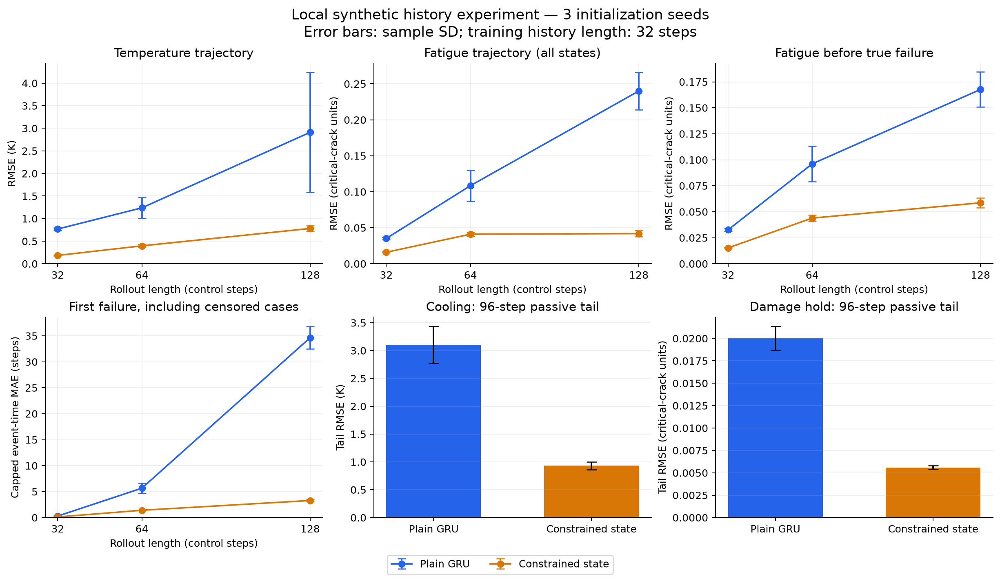
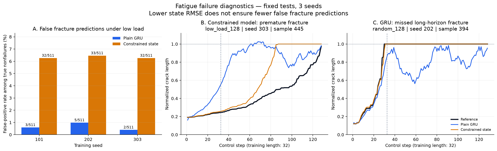

# 本地历史物理实验结果（2026-11-10）

已完成两项任务、两种模型、三个训练种子的全部 12 次训练。受约束状态模型在 4 倍训练长度的轨迹上误差更小，停止加热后持续冷却、停止载荷后保存损伤；但在低载荷长序列中，它的断裂误报率明显高于 GRU。**保持物理约束不等于准确预测断裂。**

这是可复现的合成数值实验：不包含图像编码器、视频生成器或真实材料数据。裂纹状态是临界裂纹长度归一化后的 a，a=1 代表断裂；其误差没有温度的 K 单位。以下 ± 均为 3 个训练种子的样本标准差，不是置信区间；三次训练共享数据集。

## 实验设置与公平性

- 训练种子 101、202、303。每项任务 5,000 条训练轨迹、512 条独立验证轨迹，长度均为 32。
- 每次训练 1,500 次 Adam 更新，batch=64，lr=0.001，梯度裁剪=1。相同种子的两个模型使用完全相同 minibatch 索引。均以每一步状态的 MSE 为目标，不使用 teacher forcing。
- 每 100 次更新在验证集评分，只按验证 MSE 选择 checkpoint。所有 12 次训练结束后才构造正式测试集；未根据测试结果重训或调参。
- 输入信息相同：当前控制量、时间/循环增量、材料参数、初始条件。GRU 用 64 维隐状态；受约束模型用显式预测状态和两层 112 宽 MLP 学习变化率。两者都不能读取当前真实状态。
- GRU 13,697 参数；热受约束模型 13,666，疲劳受约束模型 13,553。参数量差异小于 1.1%。本轮匹配更新次数，不匹配运行时间/FLOPs。
- 结构先验与状态表示同时改变，不能将差异解释为单独某一条约束的因果效果。两种模型未分别进行超参数搜索；这是固定预算基线比较。

本机为 Apple M2 Pro / 16 GiB 统一内存。实际运行使用 CPU FP32、2 线程；Python 3.12.13，PyTorch 2.12.1。12 次训练和定期验证的计时之和为 **119.95 秒**，正式评测约 **4.33 秒**；训练进程累计峰值 RSS 为 **334.6 MiB**，不是整机内存占用。初始化、部分保存和绘图未计入训练计时。

## 参考物理与模型先验

热参考满足 C·d(T−20)/dt=P−H·(T−20)，每个控制步用解析指数解生成。C∈[80,120] J/K，H∈[0.5,4] W/K，P∈[0,200] W（35% 停热），dt∈[0.5,5] 秒，初温 20°C。

热模型学习非负热源和散热率，更新使用指数衰减形式；它没有直接调用参考 H/C。该形式仍是强物理先验：保证当前温度不低于环境时，无输入不会反弹升温，但不能保证学到正确的散热时间常数。

疲劳参考为无量纲 Paris 型稳定增长 da/dN=k·s³·a^(3/2)，用解析步进计算并在 a=1 吸收。a₀∈[0.08,0.2]、k∈[0.04,0.12]、s∈[0.3,1.5]（25% 停载）、dN∈[0.5,1.5]。假设固定最大应力而变化应力范围，以使用固定临界裂纹阈值。未建模裂纹闭合、塑性和失稳前加速；不是金属反复大幅折叠或橡皮筋拉断的真实校准模型。

疲劳模型学习非负有限步增量，载荷为零时增量严格为零，a 达到 1 后保持 1；没有硬编码 s³ 或 a^(3/2)。这些单调、停载保持和断裂吸收性质来自架构。

## 长时程泛化

每项任务固定 512 条独立测试轨迹。32、64、128 步使用同一批 128 步序列的嵌套前缀。训练只见过长度 32；128 步是 4 倍时程外推，材料参数仍在训练范围。

| 指标（越小越好） | 普通 GRU | 受约束状态模型 |
|---|---:|---:|
| 热：32 步 RMSE / K | 0.769 ± 0.032 | 0.185 ± 0.006 |
| 热：64 步 RMSE / K | 1.238 ± 0.231 | 0.397 ± 0.032 |
| 热：128 步 RMSE / K | 2.912 ± 1.328 | 0.782 ± 0.066 |
| 疲劳：32 步 RMSE | 0.0352 ± 0.0013 | 0.0160 ± 0.0005 |
| 疲劳：64 步 RMSE | 0.1085 ± 0.0213 | 0.0411 ± 0.0028 |
| 疲劳：128 步 RMSE | 0.2400 ± 0.0262 | 0.0419 ± 0.0043 |
| 疲劳：128 步、真实断裂前 RMSE | 0.1676 ± 0.0168 | 0.0586 ± 0.0049 |
| 断裂：128 步、全样本截断事件步数 MAE | 34.647 ± 2.143 | 3.289 ± 0.176 |
| 断裂：128 步漏报率 / % | 45.94 ± 2.13 | 0.20 ± 0.00 |

随机疲劳测试在 32/64/128 步分别有 41/302/497 条真实断裂轨迹（总数 512）。128 步大量状态已吸收在 1，整体 RMSE 容易掩盖断裂前误差，因此同时报告真实断裂前 RMSE，并增加下方几乎不发生断裂的低载荷测试。

事件指标使用第一个预测 a≥0.9999 的观测步；参考事件使用 a=1。未发生事件统一记为 horizon+1，故这里的 MAE 是**包含未发生/漏报事件的截断观测步误差**，不是连续秒数或疲劳循环寿命误差。128 步真实断裂中的漏报为 GRU 217/497、238/497、230/497；受约束模型每个种子均为 1/497。

随机 128 步仅有 15 条真实未断裂轨迹：GRU 误报为 0/15；受约束模型为 4/15、6/15、1/15。这个误报率分母很小，不能据此稳定估计稀有事件性能。

## 冷却恢复与损伤不可逆性

独立 512 条序列：前 32 步允许输入，此后连续 96 步输入为零。疲劳前缀使用训练支持内的低幅载荷 [0.3,0.8]，防止先全部断裂再平凡地保持 1；所有 512 条在开始停载时都未断裂。

| 指标（越小越好） | 普通 GRU | 受约束状态模型 |
|---|---:|---:|
| 冷却尾段温度 RMSE / K | 3.103 ± 0.328 | 0.933 ± 0.069 |
| 冷却结束温度 MAE / K | 3.402 ± 0.783 | 0.257 ± 0.017 |
| 尾段总降温量 MAE / K | 3.539 ± 0.711 | 0.322 ± 0.002 |
| 冷却尾段出现局部升温的步数比例 / % | 37.10 ± 0.80 | 0.00 ± 0.00 |
| 冷却尾段低于环境温度的步数比例 / % | 1.74 ± 2.20 | 0.00 ± 0.00 |
| 无载荷尾段裂纹 RMSE | 0.0200 ± 0.0013 | 0.0056 ± 0.0002 |
| 无载荷尾段最终绝对漂移（相对自身第 32 步） | 0.0425 ± 0.0080 | 0.0000 ± 0.0000 |
| 随机 128 步中裂纹缩短的步数比例 / % | 40.49 ± 0.36 | 0.00 ± 0.00 |

物理违例容差为归一化状态 1e−5（热为 0.001 K）。比例按状态转移步统计，而非“出现任何错误的轨迹比例”。冷却尾段每个种子分母 512×96=49,152；随机 128 步裂纹缩短分母 65,536。

GRU 整体仍在冷却，但会出现局部非物理反弹，不能表述成“停止加热后总体升温”。疲劳无载荷尾段中，GRU 相对自身第 32 步的预测平均降低约 0.04249，构成模型内的损伤恢复；即使这种漂移偶然靠近真值，它仍违反不可逆性。受约束模型严格不漂移，但会一直保留第 32 步的估计偏差。

受约束模型的零违例是结构性保证，不应作为“从数据发现了物理定律”的证据。本轮的冷却恢复仅指温度回落，未测试重新加热、制动性能恢复或材料修复。

## 主要负面结果：低载荷断裂误报

低载荷测试使用独立的 512 条 128 步序列，s∈[0.3,0.8]，每一步幅值仍处于训练支持范围。只有 1 条真实断裂，另外 511 条应判为未断裂。

| 指标（越小越好） | 普通 GRU | 受约束状态模型 |
|---|---:|---:|
| 低载荷 128 步裂纹 RMSE | 0.1119 ± 0.0151 | 0.0502 ± 0.0012 |
| 低载荷 128 步断裂误报率 / % | 0.65 ± 0.30 | 6.33 ± 0.11 |
| 低载荷全样本截断事件步数 MAE | 0.271 ± 0.093 | 1.172 ± 0.051 |

| 种子 | GRU 误报 / 真实未断裂 | 受约束模型误报 / 真实未断裂 |
|---|---:|---:|
| 101 | 3 / 511 | 32 / 511 |
| 202 | 5 / 511 | 33 / 511 |
| 303 | 2 / 511 | 32 / 511 |

受约束模型在低载荷下依然有更低的状态 RMSE，却更常越过断裂阈值；不能据平均状态误差宣称事件预测全面优于 GRU。非负增量累积可能持续放大正偏差，这是待验证的解释，本次未做因果消融。

唯一真实断裂样本的受约束事件误差为 38、37、40 步；样本太少，不能据此估计总体漏报能力。这里的全样本事件 MAE 被 511 条未断裂样本主导，也必须与误报计数一起读。

## 可复查的失败案例

正式协议事先规定：每个模型、每个种子分别选最大 128 步 RMSE、最大无输入尾段 RMSE，以及疲劳最大事件步误差。共保存 30 个带选择标签的案例文件；每个案例同时包含两个模型预测，可能重复选中同一轨迹。以下是这些规则下的例子，样本编号从 0 开始：

| 条件、种子、样本 | 参考行为 | 观察到的失败 |
|---|---|---|
| 热停输入，202，153 | 第 32 步 98.17°C，最终 26.18°C | GRU 最终 40.01°C，尾段 RMSE 14.64 K；受约束最终 24.34°C |
| 热停输入，101，486 | 第 32 步 81.82°C，最终 31.05°C | 受约束冷却过快，最终 25.16°C、尾段 RMSE 7.01 K；同例 GRU 尾段 RMSE 2.83 K |
| 疲劳停输入，303，416 | 裂纹保持 0.2919 | GRU 从自己第 32 步 0.6781 回落至 0.2573；受约束保持 0.3088，仍有估计偏差 |
| 疲劳随机，202，394 | 第 30 步断裂 | GRU 到第 128 步都未报断裂，最终 0.9548；受约束第 31 步报告 |
| 疲劳随机，101，6 | 第 84 步断裂 | 受约束第 61 步报告，提前 23 步；GRU 在 128 步内未报告 |

低载荷补充图的案例是在看完测试结果后按记录在 `figures/low_load_failure_selection.json` 中的规则选出，只用于解释误报，不属于事先规定的 30 个案例，也没有参与训练或调参。图中 seed 303、样本 445 的参考裂纹在第 128 步为 0.9771，尚未断裂；受约束模型在第 87 步即报断裂并保持 1。同例 GRU 第 61 步也曾越过阈值，之后又回落，因此不能把这个样本描述为“GRU 预测正确”。

全部图： [长程最差案例](figures/worst_long_rmse.png)、[被动尾段最差案例](figures/worst_passive_tail_rmse.png)、[断裂事件最差案例](figures/worst_event_time.png)。对应 PDF 也已保存。

## 结论与后续边界

本轮支持的结论是：在这两种已知参数的合成动力学中，小型显式状态模型能在有限本地算力上学到较准确的长程数值预测，同时满足预设的冷却与不可逆性约束。低载荷误报和散热过快证明约束不充分，仍需验证变化率与临界事件的准确性。

下一轮优先把“状态表示”和“约束”分开消融：保留同一显式状态网络，比较无约束增量、仅非负增量、完整停载/吸收约束；另设 GRU 加相同输出约束的基线。低载荷校准、事件目标或更长训练历史应使用新训练/验证集和新冻结测试集。本次测试集不能用于调整阈值后再充当未见测试集。

尚未证明：真实材料可迁移性、未知材料参数推断、仅从画面识别隐状态、视频生成的物理一致性，以及约束相对其他强基线的普遍优势。三种种子也不足以支持宽泛的统计显著性主张。

## 复现、审计与原始文件

14 项自动检查覆盖参考解析解、半步一致性、数据前缀、模型因果性/有限梯度/硬约束、事件删失计分及被动尾段定义。另从 54 份保存的预测 NPZ 独立重算指标并审计 minibatch 与验证选模：1,813 项核验、0 项不一致；审计详情见 `audit_results.json`。

训练指纹：`f6e3f9399133ea83e03e21f40d49dc7919f9f24e1a282bd9a2c8309f4055c30a`。`training_manifest.json` 锁定配置与核心源文件哈希，数据 manifest 保存训练/验证/测试数组哈希，`evaluation.json` 保存评测源码哈希与训练完成文件哈希。

全部 checkpoint、逐步预测与训练曲线均在本结果目录；源码及复现命令见 [实验 README](../../../experiments/history_physics_benchmark_20261110/README.md)。正式结果的完整逐种子/均值/样本标准差/分母见 [evaluation.json](evaluation.json)。

## 关键指标逐种子明细

| 指标 | 模型 | seed 101 | seed 202 | seed 303 |
|---|---|---:|---:|---:|
| 热：32 步 RMSE / K | GRU | 0.763 | 0.804 | 0.740 |
| 热：32 步 RMSE / K | 受约束 | 0.185 | 0.179 | 0.191 |
| 热：64 步 RMSE / K | GRU | 1.160 | 1.497 | 1.057 |
| 热：64 步 RMSE / K | 受约束 | 0.380 | 0.377 | 0.433 |
| 热：128 步 RMSE / K | GRU | 2.721 | 4.325 | 1.689 |
| 热：128 步 RMSE / K | 受约束 | 0.740 | 0.748 | 0.857 |
| 疲劳：32 步 RMSE | GRU | 0.0365 | 0.0339 | 0.0351 |
| 疲劳：32 步 RMSE | 受约束 | 0.0156 | 0.0159 | 0.0166 |
| 疲劳：64 步 RMSE | GRU | 0.1264 | 0.1143 | 0.0849 |
| 疲劳：64 步 RMSE | 受约束 | 0.0405 | 0.0386 | 0.0441 |
| 疲劳：128 步 RMSE | GRU | 0.2536 | 0.2566 | 0.2099 |
| 疲劳：128 步 RMSE | 受约束 | 0.0406 | 0.0383 | 0.0467 |
| 疲劳：128 步、真实断裂前 RMSE | GRU | 0.1808 | 0.1735 | 0.1487 |
| 疲劳：128 步、真实断裂前 RMSE | 受约束 | 0.0573 | 0.0545 | 0.0640 |
| 断裂：128 步、全样本截断事件步数 MAE | GRU | 34.857 | 36.678 | 32.406 |
| 断裂：128 步、全样本截断事件步数 MAE | 受约束 | 3.273 | 3.121 | 3.473 |
| 断裂：128 步漏报率 / % | GRU | 43.66 | 47.89 | 46.28 |
| 断裂：128 步漏报率 / % | 受约束 | 0.20 | 0.20 | 0.20 |
| 冷却尾段温度 RMSE / K | GRU | 3.480 | 2.945 | 2.884 |
| 冷却尾段温度 RMSE / K | 受约束 | 0.973 | 0.853 | 0.971 |
| 冷却结束温度 MAE / K | GRU | 4.306 | 2.948 | 2.953 |
| 冷却结束温度 MAE / K | 受约束 | 0.270 | 0.238 | 0.263 |
| 尾段总降温量 MAE / K | GRU | 4.358 | 3.183 | 3.076 |
| 尾段总降温量 MAE / K | 受约束 | 0.324 | 0.324 | 0.320 |
| 冷却尾段出现局部升温的步数比例 / % | GRU | 38.02 | 36.61 | 36.67 |
| 冷却尾段出现局部升温的步数比例 / % | 受约束 | 0.00 | 0.00 | 0.00 |
| 冷却尾段低于环境温度的步数比例 / % | GRU | 0.00 | 4.21 | 1.01 |
| 冷却尾段低于环境温度的步数比例 / % | 受约束 | 0.00 | 0.00 | 0.00 |
| 无载荷尾段裂纹 RMSE | GRU | 0.0188 | 0.0197 | 0.0214 |
| 无载荷尾段裂纹 RMSE | 受约束 | 0.0056 | 0.0058 | 0.0054 |
| 无载荷尾段最终绝对漂移（相对自身第 32 步） | GRU | 0.0333 | 0.0471 | 0.0473 |
| 无载荷尾段最终绝对漂移（相对自身第 32 步） | 受约束 | 0.0000 | 0.0000 | 0.0000 |
| 随机 128 步中裂纹缩短的步数比例 / % | GRU | 40.90 | 40.23 | 40.35 |
| 随机 128 步中裂纹缩短的步数比例 / % | 受约束 | 0.00 | 0.00 | 0.00 |
| 低载荷 128 步裂纹 RMSE | GRU | 0.0970 | 0.1115 | 0.1272 |
| 低载荷 128 步裂纹 RMSE | 受约束 | 0.0510 | 0.0489 | 0.0508 |
| 低载荷 128 步断裂误报率 / % | GRU | 0.59 | 0.98 | 0.39 |
| 低载荷 128 步断裂误报率 / % | 受约束 | 6.26 | 6.46 | 6.26 |
| 低载荷全样本截断事件步数 MAE | GRU | 0.184 | 0.369 | 0.260 |
| 低载荷全样本截断事件步数 MAE | 受约束 | 1.201 | 1.113 | 1.201 |

## 训练运行明细

| 任务 | 模型 | 种子 | 参数量 | 验证选择更新步 | 训练及验证秒数 |
|---|---|---:|---:|---:|---:|
| thermal | gru | 101 | 13697 | 1500 | 8.96 |
| thermal | constrained | 101 | 13666 | 1500 | 14.36 |
| thermal | gru | 202 | 13697 | 1500 | 8.30 |
| thermal | constrained | 202 | 13666 | 1400 | 13.02 |
| thermal | gru | 303 | 13697 | 1500 | 8.86 |
| thermal | constrained | 303 | 13666 | 1500 | 13.91 |
| fatigue | gru | 101 | 13697 | 1500 | 8.85 |
| fatigue | constrained | 101 | 13553 | 1200 | 8.69 |
| fatigue | gru | 202 | 13697 | 1400 | 9.47 |
| fatigue | constrained | 202 | 13553 | 1500 | 8.74 |
| fatigue | gru | 303 | 13697 | 1400 | 8.48 |
| fatigue | constrained | 303 | 13553 | 1100 | 8.31 |
